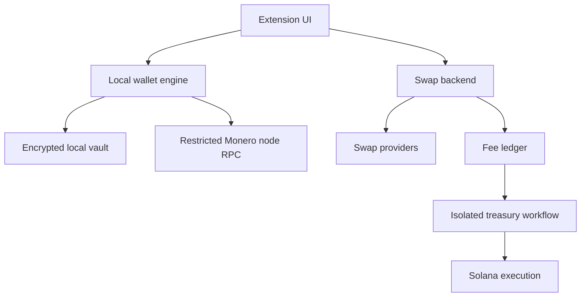

# Monero Browser Wallet — Architecture, Security and Delivery Plan

Version: 0.7 — 2026-11-07

Status: experimental local wallet implemented with Gate A/B evidence. Public engine adoption, representative chain-scale validation and independent security review remain open. DEX integration remains paused separately.

## 1. Purpose and decision status

Build a simple browser-extension wallet for native Monero (XMR), with DEX-only cross-chain swaps without KYC, a disclosed project swap fee, and a treasury policy allocating part of collected revenue to buying a project token on Solana.

This is a separate product proposal. It is not an approved addition to 0xDMme and must not inherit its accounts, database, deployment, credentials or public identity. Product name is pending. The owner selected the [project source repository](https://github.com/Oshael/Monero-Wallet). Existing 0xDMme changes and services must remain untouched.

### Confirmed direction from the owner

- Run a Monero node on the owner's existing VPS.
- Let users create/recover a wallet, receive and send native XMR, and perform swaps through decentralized protocols. Services that require, or may require, KYC are excluded; a no-registration marketing claim does not satisfy this requirement.
- No mandatory paid API subscriptions for development. Provider transaction costs are acceptable.
- Charge an additional project fee on swaps.
- Allocate part of collected fees to buying a separately launched Solana token.
- The operator must never receive users' seed phrases or private wallet keys. Security is fundamental.
- Move representative client synchronization, restoration, memory, traffic and storage feasibility measurements into Gate A, before swap implementation.
- Encrypt sensitive wallet caches and swap metadata at rest, not just the seed. Storage capacity must be measured; 10 MB is not an approved whole-wallet budget.
- Minimize identity and cross-service correlation as far as technically feasible. No claim of guaranteed anonymity; network and external-protocol observations must be documented.

### Owner review record — 2026-11-06

- Approved: early feasibility measurements (review item 4), mandatory sensitive-data encryption (item 5), and stronger metadata minimization (item 6).
- Superseded: the original custodial/intermediated swap-provider shortlist. The owner requires DEX-only execution without KYC (item 7), including recovery/refund paths.
- Research proposal, not an approved route: Relay converts a supported input asset to an intermediate asset, then a compatible DEX delivers native XMR. Literal support for every cryptocurrency, end-to-end atomicity, browser compatibility and fee collection have not been demonstrated.
- Follow-up approved on 2026-11-07: specify the local funding-verification and recovery designs for review items 1 and 2. Section 7 now defines these implementation requirements. Exact protocol/library choices and feasibility evidence remain pending; this is a design decision, not a claim of implemented protection.
- First-step sequence approved on 2026-11-07: begin with a reusable local XMR wallet prototype and an early BasicSwap architecture investigation, as detailed below. An unresolved swap integration does not block independent wallet development. Server-side coordination is acceptable only without authority to spend user funds; keeping the seed local is insufficient if the server can induce unchecked signatures.
- Still open: per-order client/backend authorization (item 3). Do not use Monero keys or the seed as backend credentials.
- No native companion application, remote user-wallet daemon, external watchtower, protocol replacement or additional user custody has been approved.

### Recommendations, not yet approved implementation decisions

- Desktop Chromium Manifest V3 first; additional browsers require their own compatibility testing.
- Non-custodial client-side wallet engine with local scanning, using an operator-hosted remote node.
- TypeScript for application code; existing Monero cryptography compiled to WebAssembly.
- A small modular backend for provider integration and accounting; a separately controlled treasury execution process.
- Protocol-supported, transparent project fee collection where compatible with the approved DEX-only/no-KYC route. Affiliate settlement is not assumed to exist in atomic-swap protocols.
- No cloud seed backup, website wallet injection, fiat ramp, user Solana custody or automatic buybacks in the first technical milestone. These are sequencing recommendations, not removal of the intended product.

The user fee rate, buyback allocation, fee basis and collection mechanism, DEX route, seed format, release budget and bought-token disposition remain open.

### First step — local wallet prototype and BasicSwap feasibility

This is the starting point for the project. Validate the architecture-defining uncertainties while building a reusable wallet core; do not wait for every swap decision before beginning independent wallet work. These two workstreams may progress independently, without reducing the intended product scope.

1. **Build the local XMR wallet prototype.** Start with the relevant Gate A dependency/license and browser-runtime checks, then develop the minimal extension-owned wallet flow covered by Gate B: local creation, encrypted storage, backup, restore, synchronization, and receiving/sending stagenet XMR. Keep keys, private view keys, transaction validation and signing on the user's device. Measure synchronization time, memory, traffic, storage and interruption/restart behavior early, including the representative workloads already required by Gate A. Stagenet transfers demonstrate correctness, not mainnet-scale performance or production readiness. Deliver a reproducible prototype, its observed limitations and measured results; retain code that meets the project's quality and security requirements for the product.
2. **Investigate BasicSwap's separation of coordination and signing.** First inspect the current source and interfaces to establish where keys, signing authority, protocol state and refund actions live. Determine whether existing interfaces can support server-side offer/message coordination and monitoring while the user's device independently validates and authorizes all fund movements. Check external-signing support and required client-side proof/recovery behavior; do not assume these capabilities exist. If the code supports a credible path, make a narrow local feasibility experiment using test assets where the protocol supports them, covering an accepted operation, rejection of tampered server instructions, and recovery/interruption behavior. Mocks alone do not prove protocol compatibility. If the separation requires material protocol changes or a different runtime, document the gap and options before implementing that alternative.

**Boundary:** our server may perform work for the swap, but must not hold user wallet keys, possess an unrestricted signing capability or cause the client to sign unchecked transactions. Run feasibility services in an isolated project-owned environment under the owner's authorization. Any dependency on a native companion, watchtower, additional custody or changed privacy policy remains subject to the existing approval boundaries.

**Completion evidence:** the wallet prototype and early measurements identify whether the chosen browser engine is viable; the BasicSwap investigation records a supported path with concrete evidence, a bounded unproven hypothesis, or a confirmed blocker. A blocker pauses the affected swap integration while independent wallet work can continue. Do not build the complete Relay composition, production swap interface, fee collection or treasury automation on an assumed BasicSwap integration. Continue through the applicable delivery gates rather than treating this first step as a public-release approval.

## 2. Recommended stack and rationale

| Layer                 | Recommendation                                                                                        | Reason and condition                                                                     |
| --------------------- | ----------------------------------------------------------------------------------------------------- | ---------------------------------------------------------------------------------------- |
| Extension application | TypeScript, strict mode                                                                               | Shared typed contracts and browser ecosystem; runtime input validation remains mandatory |
| UI                    | React with a minimal build setup such as Vite                                                         | Familiar tooling; UI must never own persistent key material                              |
| Extension platform    | Manifest V3, packaged code only                                                                       | Native desktop browser distribution; prove worker/WASM compatibility first               |
| Wallet engine         | Existing Monero Core-derived WASM library behind our adapter                                          | Reuse protocol implementation instead of writing cryptography                            |
| Backend               | TypeScript on a supported Node.js LTS; small framework such as Fastify                                | Provider adapters, validation, rate control and ledger workflows                         |
| Node                  | Official monerod release, verified distribution                                                       | Network validation and restricted remote-wallet RPC                                      |
| Persistence           | PostgreSQL for operational records and fee ledger                                                     | Transactions, uniqueness and recovery for consequential money workflows                  |
| Front proxy           | HTTPS reverse proxy; reuse established host tooling where appropriate                                 | TLS, method restrictions, timeouts and request budgets                                   |
| Treasury              | Separate process and credentials; offline/external signing initially                                  | Compromise of the web backend must not unlock treasury funds                             |
| Quality               | ESLint, TypeScript, formatting, dependency boundaries, unit/integration tests and browser smoke tests | Validate correctness and module ownership                                                |

This is a new-project stack proposal, not a request to install dependencies in the current repository. Pin actual versions after inspecting maintenance, licenses, transitive dependencies and runtime compatibility.

The previously named monero-javascript candidate now redirects upstream to monero-ts, whose documentation supports client-side browser wallets through WASM. It remains a candidate, not a verified final selection or an installed dependency. Browser/WASM support does not establish compatibility with Manifest V3 CSP, the selected build, all target CPU architectures or supported seed formats. Review upstream provenance, network compatibility and release activity; a convenient fork or package name is not sufficient evidence. Do not introduce Rust solely for perceived security: Rust can be appropriate for a maintained engine, but a new cryptographic implementation increases audit scope.

## 3. Architecture and trust boundaries

The diagram shows proposed software dependencies, not automatic transfers of user funds. The swap-provider boundary is subject to the DEX feasibility review: a local API controlling a wallet is not interchangeable with a hosted quotation API. User keys and intermediate funds must not move to our backend to make an integration easier.

### Local wallet creation does not require server-held keys

The intended extension generates wallet entropy, the seed, private spend key and private view key on the user's device through the reviewed engine. It encrypts persistent secrets locally, scans node data locally and signs transactions locally. Seed creation does not require registering a wallet with our backend or disclosing keys to a node. The node supplies chain data and relays already signed transactions; it is not the user's wallet process. This preserves local key custody, although node operators can still observe network metadata as described in section 9.

Two distinct feasibility questions must remain separate: running the Monero wallet engine in Manifest V3, and running a selected cross-chain swap protocol with its additional keys, proofs, transactions and deadlines. A native-only swap implementation does not imply that a browser wallet needs server-generated or server-held seeds. Source/intermediate-chain signing must also remain under user control, whether through a reviewed local engine or an explicitly supported user-controlled signer. Neither an unverified browser port nor a companion application is implicitly approved.

### Extension ownership

- **Vault:** encrypted persistence, versioned format, password derivation, atomic updates and recovery-safe migrations.
- **Wallet engine:** authoritative unlocked keys, scan state, transaction construction and signing. Expose narrow operations; never a generic key getter.
- **Synchronization:** bounded fetching, checkpoints, reconnect, node selection and freshness status. Engine remains authoritative for wallet interpretation.
- **Transaction approval:** immutable transaction intent, recipient/amount/fee presentation, explicit consent and matching the signed transaction to that intent.
- **Swap protocol adapter/verifier:** protocol-specific proof and funding-condition validation through reviewed libraries; prepares a verified operation for transaction approval. It cannot authorize signing, write vault internals or delegate its security decision to the quotation backend.
- **Local swap session:** authoritative user-side lifecycle, validated intent, protocol secrets, checkpoint ordering, reconciliation and deadline handling. It uses the vault for encrypted persistence and chain-specific signers for approved operations; it owns session cancellation/disposal and prevents concurrent conflicting actions.
- **Swap UI:** quote comparison, protocol identity, expiry, verified deposit instructions and session status. It cannot turn an unverified quote into a funded operation.
- **UI:** rendering and transient user input only. Seed display/import is an exceptional, narrowly scoped flow.

Use an extension-owned full tab for the first engine prototype, with a dedicated worker for expensive operations. Keep the popup a launcher/status view. Do not rely on an indefinitely running service worker or keep keys in persistent background storage to survive suspension. Closing the owning page should stop core-wallet work safely and lock the wallet. This is not an established safe lifecycle for active atomic swaps: resolve their separate refund/deadline obligations in section 7 before integration. Multiple windows require a single authoritative session/lock to prevent concurrent conflicting writes and spends.

Background synchronization or offscreen contexts are later options requiring platform-policy and lifecycle verification, not assumed permissions.

### Server ownership

- **Node gateway:** exposes only necessary restricted daemon methods; never wallet-rpc holding user wallets.
- **Provider adapters:** normalize capabilities, assets/networks, quotes, orders and statuses. No wallet secrets.
- **Swap coordinator:** idempotent provider/order bookkeeping, expiry, public status reconciliation and refund tracking. Its status is advisory to the local session; it cannot authorize funding, override locally verified conditions or hold recovery secrets.
- **Fee ledger:** immutable money events, settlements, reversals and allocation records.
- **Treasury workflow:** approved spending plans, reconciliation and execution limits; isolated from public API.
- **Public reporting:** aggregates treasury activity without publishing user swap details.

Start with a modular monolith for the backend. Separate the node and treasury by process, credentials and permissions. On the same VPS, OS isolation reduces exposure but does not protect against host-root compromise; the treasury signer should remain off that host initially.

## 4. Non-negotiable security properties

1. Seed generation uses a verified cryptographically secure random source through the reviewed wallet library. Never timestamps, Math.random, backend-generated entropy or custom seed algorithms.
2. Seed, spend key and private view key remain local. They never enter HTTP payloads, logs, telemetry, analytics, crash reports, support forms, AI tools or provider APIs.
3. Transaction signing happens locally after explicit approval. No backend endpoint or remote configuration can authorize spending.
4. Persist secrets only inside an authenticated encrypted vault. Browser storage itself is not encryption.
5. No operator password reset, seed recovery, escrow key, master key or hidden recovery mechanism.
6. Private view keys are also secrets. Do not silently switch to a light-wallet server that scans with the user's view key.
7. A backend outage must not erase or hold the wallet hostage. Recovery into a compatible independent wallet must be tested.
8. Project fees and treasury assets are separate from user principal.
9. Server messages, node responses, provider data and imported wallet files are untrusted inputs.
10. No claim that the app is unhackable, guarantees anonymity or makes a compromised device safe.

**Meaning of “we cannot access seeds”:** the intended released architecture gives the operator no remote seed-access capability. A malicious dependency, compromised browser/OS or malicious future extension update could still steal keys when unlocked. Open source, reviews, reproducible builds and release controls reduce this risk; they do not mathematically prevent a publisher from distributing malicious software. Hardware signing can reduce key exposure if later proven compatible, but does not eliminate deceptive transaction approval.

### Vault and password design

Use a reviewed encryption construction through maintained libraries, not a bespoke cipher/protocol. Evaluate a memory-hard password KDF such as Argon2id with measured device budgets and a versioned configuration. Use authenticated encryption with unique nonces, fresh salts and authenticated format/version metadata. Exact parameters and library choices are a security review deliverable.

- Never store the password, derived decryption key or plaintext seed beside the vault.
- No browser-sync storage for the vault or keys by default.
- Encrypt all persisted sensitive wallet caches and local swap metadata, not only the seed. This includes transaction history, address labels, private payment proofs, swap credentials and recovery state. Any proposed plaintext exception requires an explicit classification and owner review; implementation convenience is not an exception.
- Use atomic replacement and crash-safe migrations; preserve a valid prior vault until the new one verifies.
- Reject malformed, oversized, unsupported or tampered backups before expensive parsing.
- Password changes re-encrypt locally. A forgotten password can require the independent Monero seed backup for the XMR wallet; that seed does not unlock a separately encrypted swap backup or restore intermediate-chain keys. Older exported backups retain their own encryption credentials unless explicitly replaced.
- A password protects stored data, not an already unlocked compromised runtime.
- Local attempt delays do not prevent offline cracking of a copied vault.
- Define lock-on-inactivity, explicit lock and close/restart behavior; measure resume-from-sleep handling.
- Clear references and WASM memory where supported, terminate the engine on lock, and document that JavaScript garbage collection prevents guarantees of complete memory erasure.

The seed must briefly reach an extension-owned view for user backup/import. Avoid unnecessary copies, application-global state, error serialization and clipboard use. Never auto-copy it. Warnings cannot prevent operating-system screenshots or malware. Require a backup verification step before encouraging significant deposits.

### Storage capacity and durability

The prototype uses encrypted IndexedDB records with the owner-approved
`unlimitedStorage` permission. Chrome's default `storage.local` quota is 10 MB;
it is a quota for that API, not a hard limit for every extension storage option.
Representative engine-cache measurements remain required to validate supported
wallet capacity.

Owner decision on 2026-11-07: use encrypted IndexedDB records and declare
`unlimitedStorage` in the extension manifest. Chromium declined the plain
`navigator.storage.persist()` request in the test profile. The owner approved the
permission to protect local records from automatic eviction, while retaining
application size bounds, atomic-write failure handling and independent backups.
This does not add cloud storage or change the client-only custody requirement.

Measure realistic wallets, encrypted records, serialization overhead, retained migration copies and interrupted-write recovery. Encryption adds nonce/tag/metadata overhead; binary-to-base64 encoding adds roughly one third to binary length. Chain-scan caches, wallet outputs and recovery records can dominate seed size. KDF memory usage is a separate RAM budget, not persistent vault size. Preserve the existing valid vault on quota exhaustion or failed writes; never report an unsaved backup/checkpoint as durable, or silently discard recovery evidence to fit a quota.

### Browser attack surface

- No content scripts, arbitrary website permissions or externally connectable API for the initial wallet.
- Restrict host permissions to required origins; request additional permission explicitly for a custom node.
- Strict CSP; locally package JavaScript, WASM and workers. Enable only the WASM permission actually required; no remote executable code, eval or dynamic remote modules.
- No remote HTML, embedded provider pages or untrusted SVG in privileged UI; escape text and bundle assets.
- Validate message schemas, sender identity/context, operation permissions, request sizes and lifecycle state.
- Message identifiers prevent confusion/replay; they are not a substitute for authorization.
- UI approvals bind recipient, network, atomic amount, fee, expiry and request identity. Any material change requires new consent.
- Keep secret-bearing functionality out of generic debug tooling and production logs.
- An isolated worker is a useful boundary, not protection against arbitrary code execution in the privileged extension.
- Do not load third-party analytics, chat widgets or advertising SDKs into wallet contexts.
- Protect against address substitution: show full destination on demand and make the destination verifiable before signing.
- Decode and inspect constructed transactions with trusted local engine APIs, including extra destinations and total fee. Do not sign opaque provider-supplied transactions blindly.

### Supply chain and publication

Pin dependencies and the lockfile; review install/build scripts and upgrades. Record source commit, toolchain, dependency inventory, licenses, artifact hashes and WASM provenance for each release. Build in a clean environment and independently reproduce artifacts where feasible. Scanner success is not a security audit.

Protect Git, CI and extension-store accounts with hardware-backed MFA and minimal privileges. Separate build credentials from publication credentials; prohibit production secrets in untrusted pull-request builds. Require independent human review of cryptography integration, vault changes, spending logic, permissions and releases before public money use. Automated agents are not independent security reviewers.

An older release may contain known vulnerabilities: rollback needs compatibility and security review, not an automatic downgrade. A store signature establishes publisher provenance, not correctness.

## 5. Threat model and required evidence

| Threat                                          | Preventive controls                                                                                                      | Verification and residual risk                                                                                                                                  |
| ----------------------------------------------- | ------------------------------------------------------------------------------------------------------------------------ | --------------------------------------------------------------------------------------------------------------------------------------------------------------- |
| Website sends unauthorized signing messages     | No web injection; sender validation; approval binding                                                                    | Malicious-page tests; no signing or secret responses                                                                                                            |
| XSS through quote labels, addresses or metadata | Escaping, strict CSP, no remote markup                                                                                   | Injection corpus and browser tests                                                                                                                              |
| Stolen browser profile or vault                 | Strong password KDF, authenticated encryption, no saved key                                                              | Tamper, offline-copy and weak-password analysis; password strength remains material                                                                             |
| Backend/provider compromise changes destination | Client-owned intent, independent protocol verification, verified local signing and fail-closed funding gate in section 7 | Reject substituted destinations, scripts, refund terms and extra outputs even when the backend reports success; compromised client code remains a separate risk |
| Malicious or unreliable node                    | Local engine validation, fee bounds, explicit untrusted-node mode, alternate node                                        | Withheld/malformed data, stale tip and inflated-fee tests; remote node privacy remains limited                                                                  |
| Dependency or extension update steals seed      | Pinned builds, provenance, independent review, release MFA                                                               | Bundle review and egress tests; residual publisher/runtime trust                                                                                                |
| Browser closes during write/sign/broadcast      | Atomic vault persistence, authoritative state, transaction reconciliation                                                | Forced-close/restart tests; never blindly recreate a spend after an ambiguous result                                                                            |
| Device loss or seed-only restore during a swap  | User-held encrypted recovery bundle covering protocol state and intermediate-asset authority                             | Restore without backend secrets; incomplete/stale backups or missed protocol deadlines can still cause loss                                                     |
| Duplicate provider callback or retry            | Idempotency keys, durable state machine, unique event constraints                                                        | Duplicate/out-of-order events and unknown-order-result tests                                                                                                    |
| Host or treasury automation compromise          | Signer off public VPS, limited hot balances, spending caps                                                               | Unauthorized-spend tests; shared-host root remains a major boundary                                                                                             |
| Large concurrent restores or abusive RPC        | Per-method budgets, connection/time/body limits, monitoring                                                              | Capacity and overload tests without exposing user information                                                                                                   |

Security review must include restore height, reorgs, transaction unlock rules, change outputs, fee calculation and wallet-engine error handling. A balance must distinguish total, unlocked and stale/partially scanned states.

## 6. Node deployment and capacity

Use a dedicated service/user, verified monerod binary, private management interface and a restricted wallet-facing RPC over HTTPS. Do not expose administrative RPC or a wallet-rpc service containing users' keys.

The official size reference on 2026-10-05 was approximately 265 GiB unpruned and 105 GiB pruned. These are dated storage measurements, not capacity guarantees. Begin evaluating a pruned node; verify required historical wallet RPC responses against it before committing. Disk use grows.

A node stores a shared chain, not one copy per user. RPC has no mandatory per-call vendor charge when self-hosted. Connections, requests, active wallets and registered users are different quantities.

- Set total/per-IP connection limits, timeouts, body limits and expensive-method concurrency budgets.
- Avoid rigid per-IP policies that block shared mobile networks; test proxy real-IP handling.
- A static API key embedded in an extension is public and cannot secure a paid/unlimited resource.
- Test 10, 50, 100 and progressively higher concurrent wallets, subject to bounded load budgets.
- Mix recent wallets, day/week catch-up and old recovery. Never infer 5,000 simultaneous restores from 5,000 registered users.
- Measure RPC p95/p99 latency by method, synchronization time, error rate, egress, CPU, memory and disk latency.
- Establish acceptance budgets from measured supported-device behavior before beta.
- Perform the initial client feasibility benchmark in Gate A, including an ordinary 8 GB RAM desktop/laptop, a new wallet, weeks of catch-up, and an old restore. Measure wall-clock time, peak memory, bytes transferred, cache size and close/reopen/sleep recovery. A stagenet happy path does not establish mainnet-scale performance. Gate D expands capacity and adversarial measurements after feasibility is established.
- Let users choose a compatible alternate node; do not silently rotate through unknown operators and multiply metadata exposure.
- If the primary node fails, show cached balance as stale and do not claim a transaction succeeded without evidence.

Do not change other projects, shared services, dependencies, firewall rules or storage allocations merely because the VPS is powerful. Inventory and deployment need a scoped plan, preservation checks and rollback. No deployment is authorized by writing this document.

## 7. Swap lifecycle and fees

### Candidate providers

The owner rejected KYC-capable intermediary services. ChangeNOW and the previous Trocador/instant-exchanger route are excluded from the approved direction. A service must not be classified as a DEX just because it routes through one or uses a non-custodial marketing label. KYC screening, blockchain-address risk screening, escrow arbitration and protocol custody are different properties and must be evaluated separately.

The following is a documentation-based research snapshot on 2026-11-06, not an integration selection, audit, executable quote or guarantee of liquidity. Public source/API availability does not mean a free hosted execution service. Supported assets do not establish that every pair has an executable offer.

| Candidate                                             | Native-XMR route and published cost                                                                                                                                                                                                                                                    | Integration and present limitation                                                                                                                                                                                                                                                |
| ----------------------------------------------------- | -------------------------------------------------------------------------------------------------------------------------------------------------------------------------------------------------------------------------------------------------------------------------------------- | --------------------------------------------------------------------------------------------------------------------------------------------------------------------------------------------------------------------------------------------------------------------------------- |
| BasicSwap                                             | Atomic swaps both ways; BTC/XMR and LTC/XMR explicitly documented, PART/XMR in upstream README. 0% protocol trading/service fee; network fees and offered exchange rate still matter                                                                                                   | MIT core; JSON API controls a local BasicSwap instance and its wallets. Most relevant atomic-swap feasibility candidate. BasicSwap Web is explicitly not released yet; browser-only integration is unproven                                                                       |
| eigenwallet, formerly UnstoppableSwap / COMIT lineage | User-facing taker buys XMR with BTC; maker chooses spread, with network fees and possible anti-spam deposit                                                                                                                                                                            | GPL-3.0 repository; native client/protocol integration, not a verified public browser execution API. Refund deadline and punish path are material lifecycle risks; reverse retail flow is not established                                                                         |
| Haveno / RetoSwap                                     | XMR-based P2P trading with multisig escrow and arbitration. Haveno lists BTC, BCH, ETH, LTC, USDT, USDC, DAI, TRX, SOL, XRP, DOGE, ADA and ZEC; network/offer availability must be checked. Reto advertises 0.1% maker and 0.8% crypto taker fees, plus network fees and offer pricing | Local Haveno daemon, gRPC and haveno-ts; daemon controls the wallet. It is an interactive P2P trade lifecycle, not a generic instant-swap endpoint. Security deposits depend on offer type; no-deposit offers exist. License/distribution and chosen network must be reviewed     |
| Bisq 1                                                | BTC/XMR P2P escrow trading; BTC-denominated published fees are 0.15% maker / 1.15% taker, with a BSQ discount option; network costs and collateral also apply                                                                                                                          | Local Bisq daemon and gRPC API; external XMR payment and dispute evidence. Not a drop-in browser router. Do not apply Bisq 1 fees/protocol claims to Bisq 2                                                                                                                       |
| THORChain                                             | Planned native XMR liquidity-pool route; eventual counterpart assets depend on active pools. Liquidity/slippage and outbound fees are variable                                                                                                                                         | Public node APIs exist. Official October updates still gated XMR activation; the mainnet pool list consulted contained no XMR. Code support/stagenet is not evidence of an active production pool. Validator vaults introduce a different trust model from bilateral atomic swaps |
| Serai                                                 | Planned BTC, ETH, DAI and XMR pool architecture                                                                                                                                                                                                                                        | Official site still describes launch prospectively. No production XMR route/liquidity or executable fee schedule was verified; threshold-validator custody requires separate assessment                                                                                           |
| Athanor                                               | ETH/XMR atomic-swap implementation; network gas and maker pricing                                                                                                                                                                                                                      | Local swapd JSON-RPC/WebSocket API. Upstream was archived on 2026-09-01 and calls the implementation beta; not a production recommendation without a maintained, reviewed successor                                                                                               |
| Farcaster atomic-swap project                         | BTC/XMR protocol implementation                                                                                                                                                                                                                                                        | MIT, native daemon collection and gRPC; upstream warns about evolving mainnet software. Current usable liquidity, maintenance and browser integration not verified; research reference only                                                                                       |
| MoneroSwap                                            | Proposed native EVM-currency/XMR atomic swaps with browser UI                                                                                                                                                                                                                          | MIT project; official page points to a beta dApp and a Stable testnet contract. Production deployments, audits and liquid mainnet markets not established; experimental only                                                                                                      |

BasicSwap's wider asset catalogue additionally lists BCH, DASH, FIRO, PIVX, DCR, WOW, DOGE and NMC. That catalogue is not a verified all-pairs matrix; check the exact XMR pairing, protocol direction and liquidity before exposing an asset. In particular, do not infer scriptless-to-scriptless support from a list containing both assets.

Excluded alternatives: Wagyu explicitly states that it operates the Monero side of its bridge and is not a DEX in the strict sense; this does not satisfy the approved DEX-only route. Chainflip's published supported-chain/asset list does not establish native XMR support. Wrapped XMR traded on an EVM/Solana/Hyperliquid order book is not native XMR delivery without a separately assessed redemption mechanism.

### Relay composition — proposal under review

Potential flow: a supported source asset is converted through Relay to BTC or another verified intermediate asset, then a compatible protocol delivers native XMR. Relay documents native Bitcoin deposits/withdrawals, making BTC a candidate overlap with atomic-swap systems. Every chain, token, direction, minimum and live quote must be checked; do not advertise literal support for any cryptocurrency.

- These are two separate executions, not one proven atomic trade. Leg one may succeed while leg two expires, loses liquidity or fails. Define who controls the intermediate asset, who pays each network fee, the recoverable asset and the requote/consent boundary before implementation. No user principal or signing key may be placed on our VPS as a shortcut.
- Relay's published platform fee tiers are 0% for token bridging/wrapping, 0.01% for stablecoin swaps, 0.06% for major-asset swaps and 0.15% for minor-asset swaps, plus execution (including a published $0.02 flat component), gas, DEX impact/fees and solver rebalancing. The complete live quote governs; none of these percentages is an all-in price.
- Relay documents app fees and default per-App limits, including 50 quote requests/minute for self-serve keys. Hosted-service access, fee settlement, rate limits and commercial terms still require validation; no paid subscription or service agreement is approved by this research.
- Relay advertises a no-KYC user flow, but its current screening documentation covers every flow and addresses of depositors, recipients, refunds, recovery and app-fee recipients. Sources include TRM Labs, Chainalysis, ZeroShadow and an internal blocklist; TRM results are retained for six months. This is address screening, not proof that identity documents are required, and is a material external observation/retention boundary.
- Relay documents blocked execution after deposit and a signer-authorized withdrawal process. The recovery address must be controlled by a supported signer; an exchange deposit address is not sufficient. Refunds may incur costs or return an intermediate asset, and some errors require manual review. Validate recovery for the exact origin chain and deposit mode.
- Relay's Oracle, Allocator and Security Council create trust and pause/authorization dependencies. Do not describe the entire composed route as permissionless, censorship-free, anonymous or atomic merely because its final leg is an atomic swap.

Before selecting a route, compare net XMR received for the same input value and time, including all legs, spread, gas, slippage, refunds, project fees and minimums. No live executable quote comparison or swap was performed in this review, so there is no evidence-based cheapest-total-cost winner yet.

### Feasibility conflict and approval boundary

The expected product is a simple extension with local secrets and DEX-only/no-KYC swaps. The verified interfaces for several mature candidates control native local wallet processes; a free API does not make them safe to host for users on our backend. Additionally, eigenwallet documents a time-limited refund path and potential loss if the taker misses it. This conflicts with assuming that closing the extension can always stop an in-progress swap safely.

Affected swap implementation remains unselected. Options to investigate are a user-controlled native companion (additional installation and distribution/security review), a proven browser-capable protocol implementation (substantial feasibility/security work), or an activated and reviewed native-XMR pool protocol (different validator trust, fees and liquidity risks). None is approved as a replacement. BasicSwap is the first atomic-swap feasibility recommendation; THORChain and BasicSwap Web are monitoring candidates, not dependencies promised for launch. Core wallet feasibility and the approved documentation changes remain independent of this unresolved choice.

#### BasicSwap 0.19.1 source review

The stock JSON API cannot be used as the project's detached coordinator for user trades. Bid creation and acceptance call the local swap client. The client derives per-trade private keys from the local Particl wallet, persists proof and refund state, signs the script-chain funding transaction and invokes Monero wallet RPC to fund the XMR lock. Redemption and refund paths reconstruct the shared spend key and use a local wallet to spend the lock. [Bid API](https://github.com/basicswap/basicswap/blob/de61f913cbe7c9289dcc735df505daa6f8b19385/basicswap/js_server.py#L854) · [Key derivation](https://github.com/basicswap/basicswap/blob/de61f913cbe7c9289dcc735df505daa6f8b19385/basicswap/basicswap.py#L4971) · [Funding and recovery](https://github.com/basicswap/basicswap/blob/de61f913cbe7c9289dcc735df505daa6f8b19385/basicswap/interface/xmr/xmr.py#L570)

The API accepts a prefunded template and can expose a recovery key share. Neither provides an end-to-end external signing contract. The template path still signs with the instance's wallet. The manual recovery path combines the supplied share with the instance's local share and spends from that instance. Internal bid construction can take some externally supplied proof material, but downstream signing and recovery still derive local keys. The code has protocol-level proof and refund verification inside the instance. Moving those checks to the browser, binding them to user consent and keeping recoverable state on the user device would require a new execution boundary. [Funding template path](https://github.com/basicswap/basicswap/blob/de61f913cbe7c9289dcc735df505daa6f8b19385/basicswap/basicswap.py#L13848) · [Manual recovery](https://github.com/basicswap/basicswap/blob/de61f913cbe7c9289dcc735df505daa6f8b19385/basicswap/protocols/xmr_swap_1.py#L46)

Pause direct integration of this API. No swap experiment is warranted through the stock funded path. A browser-side BasicSwap protocol adapter could preserve a single extension install and local signing, but would require maintained implementations of the protocol proofs and both chain signers, a dependency license review, local backup checkpoints and adversarial funding and deadline tests. A user-controlled companion could reuse the native instance and move its authority off the project server, but would add installation, local transport and update security, distribution/license checks and device support. It would still need proof that user consent and recovery satisfy section 7. Neither option has an approved budget or runtime. Keep the wallet work independent and leave the swap route open until a supported candidate clears these requirements.

### Approved design for item 1 — verify before funding

The local swap session and protocol adapter own this control; the backend is an untrusted source of offers and transport data. Implement the following gate before displaying actionable deposit instructions, requesting an external-wallet transfer or signing/broadcasting a funding transaction:

1. Create an immutable local intent containing the exact assets/networks, input limit, minimum acceptable output, XMR destination, user-controlled refund/intermediate destinations, all execution legs, maximum accepted fees, expiry and protocol-specific deadlines. Use integer atomic amounts. A material change invalidates prior consent and requires revalidation and new approval.
2. Validate the selected protocol's funding conditions using maintained local protocol libraries. For atomic swaps, verify the required scripts, commitments/proofs, counterparty messages and cancellation/refund paths against the local intent before funds become locked. For a pool route, verify the reviewed contract/vault and its actual transaction semantics and trust assumptions. The exact verification checklist is a Gate A deliverable for that route; do not invent a generic proof that all DEXs provide.
3. Check the complete locally constructed or decoded transaction: chain, asset, destinations, amounts, change, fee recipients, spending approvals and any other authority it grants. Reject opaque signing requests, unexpected outputs/approvals, unsupported protocol versions and unverifiable deposit instructions. Address syntax, HTTPS, an order identifier, or a signature from our own compromised backend is not independent evidence that the requested deposit is safe.
4. Bind user consent to that verified operation and persist the required recovery checkpoint before any funding step. Only the local signer or the explicitly supported user-controlled external signer can authorize it. Backend callbacks, status fields and remote configuration cannot bypass this gate or supply new signing rules.
5. Reconcile actual chain/protocol evidence with the local session. A provider's success message is not proof of receipt. Under ambiguous or inconsistent evidence, pause additional funding and expose the appropriate local recovery action; never silently select a different destination or route.

For a composed Relay route, each leg needs its own validation and recovery assessment. A verified second-leg atomic swap cannot protect an incorrectly funded first leg. Enable a route only after its own verification requirements are demonstrated; pool/bridge trust is not equivalent to bilateral atomic-swap guarantees. If the chosen integration supplies only an arbitrary deposit address without sufficient independent protocol verification, it fails this design and must not be funded.

This protects against altered server instructions within the reviewed protocol's guarantees. It does not make malicious extension code safe, guarantee liquidity, remove counterparty/validator assumptions or eliminate deadline risks. Release controls and the separate runtime feasibility review still apply.

### Approved design for item 2 — local recovery beyond the Monero seed

Recovery has two separate deliverables: the independent Monero seed backup for the XMR wallet, and a user-held encrypted swap recovery bundle for operations whose assets or recovery authority are not reconstructible from that seed. Neither is uploaded to our backend, telemetry or support. Do not promise a single-seed multi-chain recovery scheme or derive new-chain keys from the Monero seed without a separately reviewed, compatible standard.

The local swap session owns a versioned recovery journal, encrypted and atomically persisted through the vault. For each operation, retain the reviewed protocol's required material: protocol/network versions, accepted intent, chain transaction identifiers, counterparty commitments and transcripts, local secrets or key shares, intermediate-wallet recovery material or signer references, actionable refund/cancel data, relevant heights/deadlines and the last durable checkpoint. Include only what that protocol needs. Public order IDs alone are not a recovery mechanism; never store an external wallet's seed if that wallet remains the signer.

Durability and backup requirements:

- Persist and verify the recovery material before broadcasting or revealing any protocol message that could make funds dependent on it. Record the prepared action before its external effect and reconcile the observed result afterward. A timeout after broadcast enters an unknown/reconciliation state, not an automatic second spend.
- Before funding, require a usable user-held encrypted recovery export for the assets at risk, with validated import/restore support. Map every recovery-critical checkpoint for the selected protocol in Gate A. If later steps create indispensable new material, refresh and verify the export before a dependent irreversible step. If that ordering cannot be met, block the route until a compatible recovery design is reviewed; a stale initial backup is not advertised as complete protection.
- Keep exports outside extension-managed storage under the user's control, without automatic cloud sync. Use the reviewed authenticated-encryption/backup format and a user-held decryption credential; exact format and KDF parameters remain security-review deliverables. Clearly explain that uninstalling/clearing the extension deletes local state, a forgotten backup credential may make the bundle unusable, and the Monero seed alone does not decrypt it.
- Validate bounds, format, authentication and network/protocol compatibility on import. Reconcile restored state against chain/protocol evidence before any new signature, including whether an action already happened. Treat stale or conflicting evidence explicitly; do not assume every authentic older backup is current. Do not run restored and original sessions concurrently against the same funds.
- If the first leg completes and the second does not, retain the intermediate asset under user control and provide supported resume, refund or withdrawal actions with their costs. Recover using locally held keys or the user's existing external signer, never an operator-held intermediate wallet. Document every external signer/backup dependency before funding.
- Preserve deadline information and explain which recovery actions require the app/device online and unlocked. A backup restores authority and state; it cannot extend an on-chain deadline, reverse a completed trade or guarantee recovery after a protocol penalty. Browser suspension/offline recovery must be proven for the exact route before enabling it; no unapproved watchtower or server signer is a fallback.

The vault owns encrypted storage and export/import; the local session determines required protocol material and checkpoints; protocol adapters supply route-specific resume/refund operations; transaction approval remains the signing gate. Support diagnostics are a separate, minimized, user-reviewed export without seeds, private keys, recovery bundles, preimages, secret shares or authorization credentials. A bundle containing no Monero seed can still contain spending authority and must be treated as secret.

### User flow

1. Select exact asset and network, amount and destination/refund details.
2. Fetch a short-lived quote and identify the actual protocol, counterparties and every execution leg. Reject routes outside the approved DEX-only/no-KYC policy before funding.
3. Show estimated/fixed output, quote expiry, minimums, itemized costs where available, project fee, network costs, escrow/timeout requirements and refund conditions. A requirement for KYC is an incompatible route, not an accepted review step.
4. Run the local verification gate and establish the durable recovery checkpoint and user-held encrypted backup specified above. Obtain approval for the exact verified operation. Protocol-specific formats and per-order backend authorization still require review; do not assume the Monero seed reconstructs intermediate-chain keys or swap state.
5. Initiate and fund only that verified protocol operation idempotently. XMR signing remains local; source/intermediate asset signing and ownership must be demonstrated for the chosen route before implementation.
6. Track funding, confirmations, protocol execution, payout, cancellation and recovery according to the selected protocol. Do not equate a browser session ending with an atomic-swap obligation ending.
7. Verify payout where technically possible; distinguish provider-reported completion from independently observed wallet receipt.

The backend never receives user principal for forwarding. It may see necessary swap addresses and order metadata; minimize these according to the route and do not assume that non-custodial means metadata-free.

Model route-specific states, including quoted, order-creating, awaiting-deposit, deposit-seen, confirming, exchanging, payout-pending, completed, expired, refund-pending, refunded, failed and unknown, plus intermediate-funded and applicable cancel/refund-deadline states. Define allowed transitions and recovery rather than assuming every failure can be retried. A service introducing KYC becomes ineligible for new routes; existing funds require the incident/recovery process without claiming that our UI can override that service's rules.

Timeout after creating an order requires reconciliation, not immediate creation of a second order. Authenticate callbacks according to the provider contract and confirm consequential changes against its API. Bound polling, cache public asset metadata and honor rate limits.

A completed payout is not the same as settled project commission.

### Fee collection

Prefer an explicitly supported protocol/integrator fee mechanism that avoids intercepting principal and satisfies the DEX-only/no-KYC policy. Native partner commission is not assumed in BasicSwap, eigenwallet or P2P markets. Relay app fees are only a candidate if that route is approved. Acting as a market maker would require project-owned inventory and a separate capital/risk decision. If the chosen route cannot implement the desired fee, pause fee implementation and present options; do not silently replace the desired markup with affiliate revenue or a separate charge.

Use integer atomic units and explicit asset decimals. Never JavaScript floating-point amounts for money. Define rounding, minimum fee, fee base and fee refunds.

Show the complete quote before approval. If provider costs are embedded, label them as embedded rather than inventing an exact breakdown or adding them twice. A separate project fee payment introduces failure/refund and atomicity problems and is not approved by this plan.

For planning, assume provider charges are borne through the user's accepted quote, not subsidized from project capital. The owner must confirm if “we pay the provider percentage” instead means a subsidy.

## 8. Treasury and Solana buybacks

Buybacks spend project-owned, reconciled fees only. They are not an automatic deduction from arbitrary user balances or an on-chain guarantee attached to an XMR transfer.

### Accounting and allocation

Maintain distinct ledger categories: commission pending, commission settled, reversals/refunds, operational reserve, buyback allocation, budget reserved, conversion pending, buyback submitted, confirmed and reconciled.

Suggested formula, pending owner approval:

eligible revenue = settled project fee revenue - attributable reversals - explicitly approved deductions

buyback budget = max(0, eligible revenue) × allocation percentage

Define the period, accounting asset, valuation source and whether operating costs are deducted. Never call gross user trading volume “revenue.” Keep source-asset amounts; do not add XMR and SOL as numbers without conversion.

### Execution boundary

- Begin with reviewed manual treasury transactions and reconciled reports; automate only after policy approval and tests.
- Convert settled fees into the execution asset when needed. XMR-to-Solana conversion is a separate trade, with its own costs and risks, and must use a separately verified route consistent with the DEX-only/no-KYC policy. A BTC-to-XMR-only taker route does not establish the reverse treasury route.
- Use a dedicated Solana treasury; never derive its keys from a user seed or store the signer with the swap backend.
- Allowlist the exact mint, token program, destinations and approved transaction behavior.
- Check quote expiry, liquidity, expected output, slippage, price impact, all instruction effects and signer requirements.
- Maintain daily/per-order caps and a SOL fee reserve. A failed/unknown submission must be reconciled before rebuilding and signing another transaction.
- Batch only when economical; no obligation to execute a loss-making dust buyback.
- Stop on abnormal pricing, unavailable routes, insufficient liquidity, unexpected authorities or reconciliation mismatch.
- Do not trade to manufacture volume or promise price support, profit or a guaranteed buyback schedule.

Jupiter is a candidate for Solana execution. Its published free tier currently has rate limits; “free API” does not eliminate execution costs. Actual token routability depends on liquidity and supported venues, not merely creating a mint.

Decide whether acquired tokens are held, burned or otherwise allocated. Do not imply burning unless tokens are actually burned and verifiable. Token launch costs, liquidity provision, initial allocation and mint/freeze authorities are a separate workstream and budget.

Publish aggregate policy and executed treasury transaction references without exposing user addresses or per-user fees. XMR-side revenue is not publicly auditable merely by publishing a Solana buyback transaction; explain reconciliation limits and any assurance method accurately.

## 9. Privacy, retention and incident response

| Data                                       | Intended location                              | Policy                                                                                                                             |
| ------------------------------------------ | ---------------------------------------------- | ---------------------------------------------------------------------------------------------------------------------------------- |
| Seed/private keys/password                 | User device only                               | Never transmit or log; no operator recovery                                                                                        |
| Encrypted vault and wallet cache           | Local extension storage                        | User-controlled deletion/export; no default cloud sync                                                                             |
| Swap recovery journal and encrypted bundle | Local vault and user-controlled offline export | Secret recovery authority; never upload to backend/support; checkpoint and restore requirements in section 7                       |
| Support diagnostics                        | User-reviewed minimized export                 | No wallet/protocol secrets, recovery bundle or authorization credentials; identifiers only when necessary and explicitly disclosed |
| Provider credentials                       | Backend secret storage                         | Never shipped as confidential secrets in the extension                                                                             |
| Order/destination/refund metadata          | Backend/provider as necessary                  | Minimize, restrict access, encrypt backups; retention duration must be approved                                                    |
| IP/security access records                 | Gateway only as operationally necessary        | No default full RPC payload logs; short explicit retention                                                                         |
| Accounting/treasury records                | Restricted ledger                              | Retention based on applicable obligations; aggregate public reporting                                                              |

Retention durations and applicable accounting requirements are launch decisions, not an excuse for indefinite storage. Disabling application logs does not erase reverse-proxy, hosting or provider records.

### Approved metadata-minimization direction

- Do not require a real-name profile or add email, analytics identifiers, device fingerprints or reusable user identifiers to basic wallet operation. Define any necessary swap authorization independently of a persistent identity; the specific authorization mechanism is not yet selected.
- Do not share persistent user identifiers between node access and swap services, or routinely correlate RPC activity with swap records. Keep access roles, data purposes and retention scopes separate. Service separation on one host does not prevent root access or traffic observation.
- Keep RPC payloads, wallet addresses, payment proofs and per-order details out of general access/application logs. Prefer aggregate operational measurements with explicit budgets and minimal retention. Apply deletion policies to proxies, error reporting and backups as well as the database.
- Node and protocol operators can still observe timing, IP addresses and other metadata available to their role. Document who can see each leg and which transaction/address relationships are public. Entering Monero does not erase earlier public-chain history.
- Assess a supported Tor/proxy transport and DNS/traffic-leak behavior as a separate feasibility question. Chromium extension installation does not provide Tor automatically. Do not introduce an external relay/watchtower or weaken the privacy baseline without an explicit decision about the actual metadata and retention effects.
- External retention must be disclosed and assessed before route approval; our deletion policy cannot remove records held by Relay or another independent operator. In particular, the Relay screening behavior documented in section 7 remains a pending privacy decision.

Have an incident playbook before beta: disable affected swap routes or treasury execution, revoke compromised credentials, preserve minimal necessary evidence, communicate affected versions and safe recovery steps. Remote controls must not export keys, sign, alter user destinations or destroy local wallets.

If secrets may have leaked, password changes do not secure the old seed: users need a newly generated wallet and a carefully verified migration process. Never request their seed for diagnosis or recovery.

## 10. Cost and legal feasibility

The existing VPS can avoid a new node subscription, but bandwidth, maintenance, backups and security review are real operating requirements. Chrome Web Store registration has a one-time fee; test assets, mainnet validation, swaps, token launch, liquidity and buybacks require funds. No mandatory paid API is a constraint, not a promise of zero-cost public operation.

Before launch, obtain a jurisdiction-specific review of fee-charging swap intermediation, provider terms, privacy/data protection, tax/accounting and token promotion. In Brazil, BCB rules on virtual-asset service providers and CVM guidance on the economic substance of tokens are relevant review inputs. Do not conclude that non-custody automatically exempts the business, or that a revenue-funded buyback token is automatically a security. Classification requires the actual operating model.

No paid provider, material privacy reduction or changed custody model may be adopted silently to bypass a blocker. A launch requiring paid specialist review may require a budget decision; do not label an unaudited wallet safe because development itself was free.

## 11. Delivery gates and acceptance evidence

Begin with the two workstreams in section 1. Gate A is evaluated per dependency: the wallet prototype can proceed into the relevant Gate B checks once its own prerequisites pass, while swap feasibility remains open. A scoped BasicSwap feasibility experiment informs Gate A; it is not approval to ship the integration or skip Gate C. All relevant gates still apply before release.

### Gate A — feasibility and dependency review

- Reproduce candidate WASM builds and verify license/maintenance/network compatibility.
- Prove Manifest V3 CSP, worker startup, persistence, close/restart and lock behavior.
- Validate the seed/restore format in an independent compatible wallet.
- Measure realistic client synchronization/restoration before implementing swaps: new wallet, weeks offline, old wallet recovery, an ordinary 8 GB RAM machine, memory/traffic/storage peaks, quota exhaustion, and close/reopen/sleep behavior. Define acceptance budgets from measurements and record dataset/chain scale; stagenet correctness alone is insufficient performance evidence.
- Confirm DEX-only/no-KYC eligibility, free development/API access conditions, actual native-XMR route availability and the exact project fee mechanism. Record each source-chain and intermediary trust/retention boundary.
- Resolve local-vs-hosted wallet API ownership, supported runtime, atomic-swap deadline/recovery behavior and intermediate-asset control before integrating a swap route into the product. Use the source investigation and, where feasible, the scoped experiment in section 1 to establish these facts. Test chain support in both user and treasury directions rather than assuming symmetry.
- Specify each route's locally verifiable funding conditions, required recovery material, external signer dependencies and backup checkpoints. Reject routes that cannot meet the approved funding/recovery gates without giving the operator user keys.
- Document unresolved commercial/privacy/security conflicts before affected implementation.

**Observed evidence:** The [offline MV3 probe](experiments/wallet-mv3/README.md) exercised the published `monero-ts@0.11.22` worker and the worker assembled with the project-compiled WASM in Chromium. They created stagenet wallets offline and restored the same primary address. The official Monero CLI `0.18.5.4` restored the same address from the generated 25-word mnemonic and rejected a modified checksum word. Wallet creation called the browser's secure RNG and failed when it was denied. The independently compiled candidate passed loopback JSON, binary and HTTP 503 cases. After a browser transport correction, it passed Digest authentication, wrong-password rejection and a one-block offline regtest wallet sync against official `monerod` `0.18.5.4`. Encrypted persistence, representative sync measurements and funded stagenet flows remain pending. Section 7 records the separate BasicSwap API blocker.

**Subsequent wallet evidence:** [The implementation record](docs/WALLET_IMPLEMENTATION.md)
supersedes the earlier persistence and toolchain pending items. Encrypted
IndexedDB, backup/import, password rotation, worker locking and cold signing have
passing contracts. A clean Emscripten 6.0.13 build reproduced the tested native
artifact byte for byte. Funded regtest covered integrated addresses, exact receipt,
approved fees and detached-confirmation recovery. Live-stagenet funded flows and
representative synchronization measurements remain pending; none of this is a
public-release approval.

**Engine adoption hold**

The [dependency review](experiments/wallet-mv3/README.md#dependency-review) found an unsupported OpenSSL series in the default build recipe and two affected JavaScript dependency versions in the worker. The project worker updates those dependencies and omits the Node crypto polyfill. The project native build generated OpenSSL LTS headers and completed without linking `libssl` or `libcrypto`, according to its linker command and map. Aborting OpenSSL-related stubs remain among the unresolved native paths. The candidate still requires native license, toolchain and required-operation reachability review and the remaining wallet feasibility evidence before adoption.

**Owner decision**

Look for a corrected upstream revision first and maintain a project build of the same engine if the upstream review yields no suitable revision. The registry, release tag, default branch and relevant public branches and pull requests reviewed did not provide those fixes. Start the project build by isolating the browser worker's JavaScript changes from the native WASM source rebuild. The worker build owns the dependency lock, bundle assembly and the narrow browser HTTP adapter correction. Upstream retains the wallet protocol, key custody and Digest authentication calculation. Candidate validation must cover licenses, worker behavior, recovery and node synchronization. A replacement engine remains a separate decision.

The [project worker build](experiments/wallet-mv3/README.md#project-worker-build) pins newer JavaScript dependencies and removes the Node crypto polyfill from the browser bundle. A clean reinstall reproduced the initial JavaScript worker with the published WASM. The [native source build](experiments/wallet-mv3/README.md#native-build-results) subsequently compiled a new WASM from pinned sources and passed the offline creation, entropy, CLI recovery and loopback RPC checks. Its native artifact differs from the published WASM. The linker reported seven undefined symbols; the complete glue inventory found 13 aborting missing-function stubs, all also present in the published glue. Required browser operation reachability remains unverified. The [authenticated daemon regression](experiments/wallet-mv3/README.md#authenticated-daemon-regression) reproduced the earlier HTTP Digest timeout, then passed with a fetch-adapter correction that leaves the upstream Digest calculation unchanged. The native payload was unchanged by that correction.

The owner authorized Git source synchronization and moving isolated compilation
and testing to the existing VPS, then removed the agent-imposed VPS resource
ceilings. Use project-owned directories and containers and preserve unrelated
projects. Client safety limits still apply. Host package changes, shared service
restarts, deployment and mainnet activity require their own authorization. The
interrupted local VM compilation is incomplete evidence; the completed isolated
VPS builds provide the subsequent native evidence.

### Gate B — local wallet proof on stagenet

- Create, backup, recover, receive, send and reconcile change.
- Distinguish pending, unlocked and stale balances.
- Test interrupted scans, node failures, reorg handling, locked outputs and repeated send attempts.
- Confirm independent recovery after deleting the extension's local data.
- Capture test-only network traffic and storage snapshots to verify no test seeds/private keys/passwords leave or persist in plaintext.

Egress tests are evidence for tested paths, not proof against every possible malicious encoding or future update.

### Gate C — swaps and accounting

- Test expiry, wrong network, below-minimum, under/overpayment, late deposit, cancellation and refunds using the selected protocol. Test first-leg success/second-leg failure, changed quotes, offline refund deadlines and incompatible-route rejection before funding. No KYC-capable fallback is allowed.
- Simulate a compromised backend returning valid-looking attacker addresses, altered refund conditions, wrong assets/networks, stale quotes, forged completion and extra transaction outputs/approvals. Assert that no actionable deposit instructions, funding signature or broadcast bypass local verification and consent.
- Interrupt writes and broadcasts at recovery-critical checkpoints; test quota failures, duplicate attempts and unknown outcomes without duplicate funding. Delete extension state and restore test operations from the user-held encrypted bundle, including the intermediate-funded state and refunds, while backend access is unavailable.
- Exercise corrupted, stale, wrong-password and incompatible backups, seed-only restores, unavailable external signers and protocol deadline boundaries. Incomplete recovery must be reported accurately; never claim that seeds or exports override expired refund rights.
- Use mocks for deterministic failures; real provider tests still need a bounded budget.
- Verify idempotency, authentic callbacks, pending-vs-settled commission and quote disclosure.
- Verify monetary arithmetic, rounding, duplicate settlements and reversals.

### Gate D — security and capacity

- Independent review of vault, signing, extension permissions, dependencies and release pipeline.
- No unresolved critical/high exploitable findings affecting funds or secrets.
- Run adversarial message/input tests and crash recovery tests.
- Extend the Gate A feasibility measurements to realistic concurrent wallet synchronization mixes on the actual node and supported clients; do not postpone basic client feasibility to this gate.
- Record p95/p99, errors, transfer volume and resource headroom; do not advertise a concurrency number without evidence.
- Test incident response, node failover and backup restoration.

### Gate E — controlled beta and public release

- Explicitly document supported browsers/devices, limits and known risks.
- Begin with consenting testers and small amounts; passing tests is not a reason to solicit large deposits.
- Verify store package matches reviewed source/build; publish security contact and release notes.
- Complete protocol/integration eligibility and legal/policy review under the approved DEX-only/no-KYC requirement.
- Expand only after failure reports and measurements support it.

### Gate F — treasury execution

- Owner approves fee basis, allocation, mint, token disposition, reporting and limits.
- Reconcile actual provider settlements.
- Exercise manual buyback accounting first.
- Test repeated jobs, ambiguous chain submission, price anomalies and signer isolation before automation.
- Wallet sending/recovery remains independent of token success or buyback service uptime.

## 12. Open decisions and next action

| Decision                               | Recommended starting point                                                            | Required evidence/owner input                                                                                              |
| -------------------------------------- | ------------------------------------------------------------------------------------- | -------------------------------------------------------------------------------------------------------------------------- |
| Product identity                       | Separate from 0xDMme                                                                  | Public name pending; source repository selected by owner                                                                   |
| Engine and seed format                 | Maintained Core-derived WASM                                                          | Compatibility, provenance and recovery proof                                                                               |
| Wallet architecture                    | Local scanning, no shared view key                                                    | Browser performance proof                                                                                                  |
| Browser support                        | Desktop Chromium first                                                                | Explicit support matrix                                                                                                    |
| DEX route                              | Evaluate BasicSwap first; monitor browser/pool alternatives                           | DEX/no-KYC eligibility, native XMR, runtime, liquidity, licensing, timeouts and recovery; none selected                    |
| Relay first leg                        | Owner proposal under investigation                                                    | Supported intersection, intermediate control, screening/retention, recovery, all-in cost and explicit route approval       |
| Funding verification and swap recovery | Approved local verification gate and user-held encrypted recovery design in section 7 | Route-specific proofs, signing/runtime feasibility, backup format/checkpoints and restore evidence remain pending          |
| Per-order backend authorization        | Separate least-privilege credentials, without persistent identity where feasible      | Item 3 remains open; never use Monero keys/seed as backend credentials or include authorization secrets in support exports |
| Project fee                            | Supported disclosed fee without principal custody                                     | Mechanism, percentage, basis, refund policy and reverse treasury route                                                     |
| Buyback allocation                     | Settled revenue only                                                                  | Percentage and deductions                                                                                                  |
| Treasury custody                       | External signer initially                                                             | Signers, caps and operational procedure                                                                                    |
| Token                                  | Separate Solana workstream                                                            | Mint, authorities, liquidity and disposition                                                                               |
| Data retention                         | Approved minimization; explicit schedules still pending                               | Operational/legal needs, deletion propagation, correlation limits and external retention                                   |
| Public launch budget                   | Separate from free development                                                        | Security review, store fee and test capital                                                                                |

**Next action**

Review native dependency licenses, the toolchain and all missing-function stubs using the compiled candidate. Validate the public wallet API, including data-based export/reopen and the required paths' reachability, before implementing encrypted persistence and representative node synchronization measurements. Keep swap execution paused until a route supports client-side verification, signing and recovery.

## 13. Source register

Initial sources reviewed on 2026-11-06; client-side wallet documentation, remote-node boundaries and BasicSwap API authority rechecked on 2026-11-07. Specifications, provider terms and prices may change. Approved design requirements are recorded separately from unselected implementation proposals; no benchmark, security audit, executable quote comparison or provider integration has been completed. Protocol/DEX documentation and one public THORChain pool listing were inspected; an independent direct network probe was unavailable in this environment. Absence of a verified route is not proof that no implementation could ever support it.

- Monero node/remote-node architecture and privacy: https://docs.getmonero.org/interacting/remote-nodes/
- Monero daemon configuration and RPC limits: https://docs.getmonero.org/interacting/monerod-reference/
- Monero size reference: https://docs.getmonero.org/technical-specs/
- Wallet RPC contracts: https://docs.getmonero.org/rpc-library/wallet-rpc/
- Candidate WASM package documentation: https://www.npmjs.com/package/monero-javascript
- Current candidate upstream and browser/client-side wallet documentation: https://github.com/woodser/monero-ts
- Light-wallet server and view-key model: https://github.com/vtnerd/monero-lws
- Chrome service-worker lifecycle: https://developer.chrome.com/docs/extensions/develop/concepts/service-workers/lifecycle
- Chrome extension CSP/WASM: https://developer.chrome.com/docs/extensions/reference/manifest/content-security-policy
- Extension storage is not encrypted: https://developer.mozilla.org/en-US/docs/Mozilla/Add-ons/WebExtensions/API/storage
- Browser-extension threat guidance: https://cheatsheetseries.owasp.org/cheatsheets/Browser_Extension_Vulnerabilities_Cheat_Sheet.html
- Chrome publisher MFA: https://developer.chrome.com/docs/webstore/program-policies/two-step-verification
- Chrome registration: https://developer.chrome.com/docs/webstore/register
- Historical, rejected provider — ChangeNOW commercial overview: https://changenow.io/api
- Historical, rejected provider — ChangeNOW AML/KYC policy: https://changenow.io/terms-of-use/aml-kyc
- Historical, rejected provider — ChangeNOW API terms: https://changenow.io/terms-of-use/changenow-api
- Historical, rejected instant-exchanger route — Trocador API: https://noscript.trocador.app/docs/
- Jupiter API pricing and free-tier limits: https://developers.jup.ag/pricing
- CVM Guidance Opinion 40: https://conteudo.cvm.gov.br/legislacao/pareceres-orientacao/pare040.html
- BCB authorization and virtual-asset service references: https://www.bcb.gov.br/estabilidadefinanceira/autorizabc

### Owner-review research references

- Chrome storage quota and persistence: https://developer.chrome.com/docs/extensions/reference/api/storage
- Monero restore/cache limitations: https://www.getmonero.org/resources/user-guides/change-restore-height.html
- Monero payment proofs: https://www.getmonero.org/resources/user-guides/prove-payment.html
- BasicSwap fees, directions and runtime: https://basicswapdex.com/faq
- BasicSwap local JSON API and wallet authority: https://basicswapdex.com/docs/api
- BasicSwap asset catalogue and MIT license: https://github.com/basicswap/basicswap
- BasicSwap Web unreleased status: https://basicswapdex.com/web
- eigenwallet overview and maker model: https://docs.eigenwallet.org/
- eigenwallet current swap flow: https://docs.eigenwallet.org/getting_started/first_swap
- eigenwallet refund/punish lifecycle: https://docs.eigenwallet.org/advanced/refund_punish
- eigenwallet GPL-3.0 source and COMIT lineage: https://github.com/eigenwallet/core
- Haveno wallet-owning local API: https://docs.haveno.exchange/users/haveno-api/
- Haveno XMR-paired assets: https://docs.haveno.exchange/overview/assets/
- RetoSwap published fee schedule: https://retoswap.com/
- Bisq 1 fees: https://bisq.wiki/Trading_fees
- Bisq 1 XMR trade/payment-proof flow: https://bisq.wiki/Trading_Monero
- Bisq API reference project: https://github.com/bisq-network/bisq-api-reference
- THORChain XMR activation gates, 2026-10-21: https://blog.thorchain.org/thorchain-protocol-upgrade-v3-21
- THORChain activation discussion, 2026-10-22: https://blog.thorchain.org/monero-on-thorchain-waits-on-v3211-swapkit-rev-share-and-2-second-blocktime
- THORChain public pool list consulted without an XMR pool: https://gateway.liquify.com/chain/thorchain_api/thorchain/pools
- THORChain native-XMR design: https://dev.thorchain.org/chain-clients/monero-design.html
- Serai launch/asset description: https://serai.exchange/
- Athanor archived beta source: https://github.com/AthanorLabs/atomic-swap
- Farcaster atomic-swap node: https://github.com/farcaster-project/farcaster-node
- MoneroSwap experimental browser/testnet project: https://moneroswap.eth.limo/
- Wagyu bridge-operator disclosure: https://wagyu.xyz/
- Chainflip supported chains/assets: https://docs.chainflip.io/protocol/supported-chains-assets/chains-assets
- Relay native Bitcoin integration: https://docs.relay.link/references/api/api_guides/bitcoin
- Relay cost components: https://docs.relay.link/references/api/api_core_concepts/fees
- Relay app fees: https://docs.relay.link/features/app-fees
- Relay API keys/rate limits: https://docs.relay.link/references/api/api-keys
- Relay no-KYC user-flow claim: https://relay.link/blog/how-to-use-relay-swap
- Relay transaction screening and retention: https://docs.relay.link/security/transaction-screening
- Relay trust model and audit scope: https://docs.relay.link/references/protocol/security
- Relay refunds: https://docs.relay.link/references/api/api_core_concepts/refunds
- Relay execution/recovery errors: https://docs.relay.link/references/api/api_core_concepts/execution-errors
- Relay signer-authorized withdrawals: https://docs.relay.link/references/protocol/guides/withdrawals
- Relay terms and quote/address metadata: https://relay.link/terms
